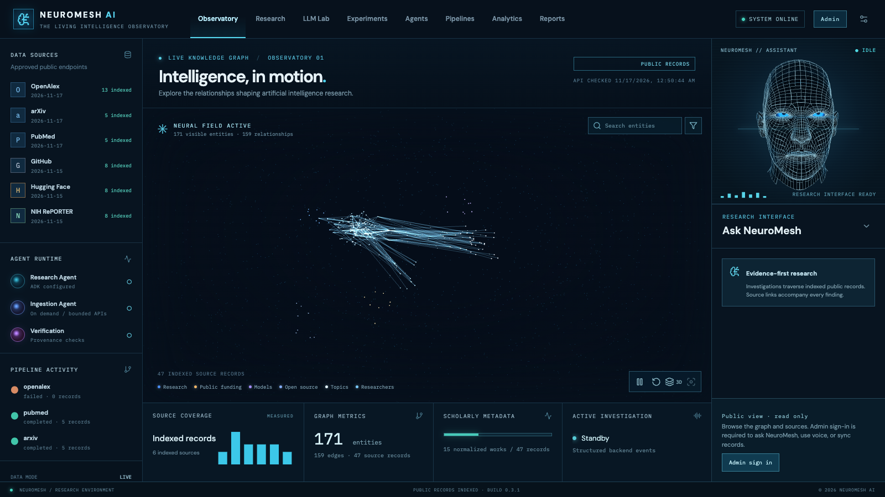

# NeuroMesh AI

NeuroMesh AI is an open-source workbench for exploring public AI and scientific research as an evidence-linked 3D graph. The present build investigates scholarly metadata and asks whether structured memory can improve an AI research assistant's retention, knowledge updates, and source attribution. That improvement remains a hypothesis.



The image is a Playwright capture of the deployed React/FastAPI application with the existing animated 3D face and source-backed graph. It is not a concept render. Decorative ambient particles are not research entities.

## What works

The Observatory renders source-backed entities and typed relationships, animated graph movement, camera controls, search, filtering, an evidence inspector, and the existing holographic face. Public visitors can browse these records but cannot ask questions or change data. Admin sign-in with the private operator token unlocks typed questions, voice, and source sync. Indexed questions stream real investigation events that highlight the cited graph path. Gemini research and verification require a separate Admin switch. The face responds to assistant state; its mouth follows playback amplitude for Cloud TTS audio or browser speech timing. This is approximate speech synchronization, not phoneme-level lip sync. Microphone permission is requested on user action, and raw recordings are not stored by NeuroMesh.

Research searches indexed source records and filters by source, year, topic, and institution. Pipelines shows actual sync jobs and failures. Analytics computes graph measures and deterministic title clusters. Agents shows recorded operator-only executions. The Cognitive Research Laboratory shows real dataset and run state; it does not display fabricated rankings. The current pilot dataset is pending human review and has no real model runs.

The live Cloud Run build has ingested OpenAlex, arXiv, and PubMed records. The same source-backed graph, memory schema, and research assistant are available locally. The release commits have not been pushed to GitHub.

## Architecture

```text
Approved public APIs → bounded connectors → versioned source records
                                         ↓
                           normalized scholarly metadata
                                         ↓
                       evidence-linked entities and edges
                                         ↓
React / Three.js ← graph JSON + SSE ← FastAPI → SQLite or PostgreSQL
                                          ├→ deterministic retrieval and analytics
                                          ├→ operator-only ADK research/verification
                                          └→ operator-only speech and lab records
```

See the [architecture audit](docs/architecture-audit.md), [system architecture](docs/system-architecture.md), and [data provenance](docs/data-provenance.md). The frontend uses React 19, TypeScript, Vite, React Three Fiber/Three.js, Tailwind CSS, and ECharts. The backend uses FastAPI, SQLite locally or Cloud SQL PostgreSQL, NetworkX, and optional Google ADK/Vertex AI and Cloud Text-to-Speech. Pytest, Vitest, and Playwright cover backend, frontend, and browser behavior.

Each paper preserves a source identifier, original URL and response, normalized identifiers/authors/topics/references, retrieval time, validation state, and version history. Visible `AUTHORED_BY`, `AFFILIATED_WITH`, `HAS_TOPIC`, and `CITES` edges carry source evidence. Citation edges appear only when both works are indexed. When source metadata changes, withdrawn relationships leave the current graph while raw history remains. See [graph and memory design](docs/system-architecture.md).

| Source | Current connector | Access |
| --- | --- | --- |
| [OpenAlex](https://help.openalex.org/data/works/attributes/) | Works, authorships, topics, references | Public API; optional key |
| [arXiv](https://github.com/arXiv/arxiv-docs/blob/develop/source/help/api/user-manual.md) | Atom paper metadata | Public API |
| [PubMed](https://www.ncbi.nlm.nih.gov/sites/books/NBK25499/) | ESearch and EFetch metadata | Public E-utilities; local developer email |
| [GitHub](https://docs.github.com/en/rest/search) | Public repositories | Public API |
| [Hugging Face Hub](https://huggingface.co/docs/hub/api) | Public models | Public API |
| [NIH RePORTER](https://api.reporter.nih.gov/) | Public awards | Public API |

The source-specific parsers run deterministic validation. Google ADK is the optional, operator-only orchestration layer for research and verification; it cannot execute arbitrary shell commands or SQL. Admin questions default to bounded deterministic retrieval. The separate Gemini switch opts into model calls. An answer cites source URLs and treats any broader interpretation as uncertain. Model calls have separate quotas and explicit enablement.

## Research method

The [cognitive proposal](research/proposal.md) compares A (no retrieval), B (sparse title retrieval), C (graph paths), and D (hybrid retrieval and memory). The local runner records model ID, dataset fingerprint, prompt version, per-trial output, scores, latency, tokens, cost when configured, and errors. Draft tasks require source review before a run. The current pilot only checks first-author attribution; it does **not** test long-term retention or prove that D is better. No paid provider evaluation has run. See [methodology](docs/research-methodology.md), [hypotheses](research/hypotheses.md), and [roadmap](docs/research-roadmap.md).

The earlier question about 2023–2026 research growth, public investment, open-source implementation, and adoption remains a separate, unrun protocol in [research methodology](docs/research/methodology.md). No correlation or causal result is claimed.

## Local development

Requires Node 24 and Python 3.11+.

```bash
cd /path/to/neuromesh-ai
npm ci
python3 -m venv .venv
.venv/bin/pip install -e 'services/api[test,agents]'
.venv/bin/uvicorn neuromesh_api.main:app --host 127.0.0.1 --port 8000
```

In another terminal:

```bash
cd /path/to/neuromesh-ai
npm run dev
```

Open `http://127.0.0.1:5173`. The API shows an empty graph until real records are ingested. The local SQLite database is ignored by Git. Sync a bounded sample:

```bash
.venv/bin/python scripts/sync_public.py --source openalex --query 'continual learning' --limit 5
.venv/bin/python scripts/sync_public.py --source arxiv --query 'continual learning' --limit 5
NCBI_EMAIL=your-contact@example.org .venv/bin/python scripts/sync_public.py --source pubmed --query 'continual learning neuroscience' --limit 5
```

Keep `NCBI_EMAIL` and `NEUROMESH_ADMIN_TOKEN` in local or secret-managed configuration. The latter unlocks admin sign-in for research questions, source sync, Cloud TTS, agent history, memory sessions, and lab reads. `scripts/research_lab.py` supports local dataset drafting, source inspection, task review, and experiment registration without calling a model. `NEUROMESH_DATABASE_URL` selects PostgreSQL. See [.env.example](.env.example) for optional settings.

## Google Cloud

**Live Observatory:** [NeuroMesh AI on Cloud Run](https://neuromesh-observatory-wwtovkiwnq-uc.a.run.app/). Release 0.3.1 uses the existing `moesautomationweekly` project with Cloud Run and Cloud SQL. The [deployment runbook](docs/architecture/gcp-deployment.md) and [cost notes](docs/architecture/costs.md) document the existing resources and guardrails. The project has a $40 monthly alert with $10, $25, and $40 notifications; alerts do not cap billing.

The deployed database held 47 public source records on 2026-11-16, including 15 normalized scholarly works, 171 visible source-backed entities, and 159 evidence-linked current relationships. These are observed counts from a bounded six-source index, not research findings or estimates of source coverage. Visitors can browse and filter. Research questions, voice, and ingestion require Admin sign-in; the API rejects unauthorized POST requests. The token is never committed or shown in this README.

For operator research, open the live Observatory, click **Admin**, and sign in with the current token. Copy it directly to the clipboard in a private terminal with `cd infrastructure/terraform && ../../.local/bin/terraform output -raw operator_token | pbcopy`, then paste it into the Admin form. Indexed questions use stored evidence without a model call; select **Use Gemini agent for questions** when you want a capped model investigation. For voice, enable voice mode and unmute the assistant; **Talk** requests microphone permission on click. Browser speech recognition requires a working Chrome recognition service and input device. Stop interrupts playback. Keep the token out of chats, shared terminals, and screenshots.

## Validation and limitations

```bash
npm run build
npm test
.venv/bin/pytest -q services/api/tests
npm run test:e2e   # with API and web servers running
node scripts/capture_observatory.mjs
```

Local tests exercise source parsing, lineage, relationship withdrawal, memory, experiment cost gates and exports, audio behavior, graph navigation, and cited investigations. The PostgreSQL integration test passed against an isolated local instance. Release 0.3.1 passed 13 Playwright browser tests against Cloud Run, including guest denial, invalid Admin sign-in, authorized cited retrieval, voice controls, and sign-out. The live API check also confirmed read-only guest access and an authenticated evidence path without paid provider calls. A prior 0.3.0 test verified a bounded ADK investigation, Cloud TTS WAV generation, and Chrome audio playback with 20 nonzero PCM face-animation frames and interruption. Physical microphone behavior still depends on Chrome permission and device support. The live graph is small; cross-source identity resolution, scheduled incremental ingestion, graph expansion, dense retrieval, full cognitive benchmarks, and real repeated provider trials remain in progress. [Research results](research/results/README.md) are intentionally empty until measured evidence exists.
