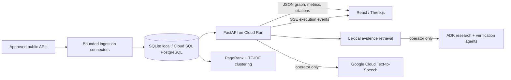

# System architecture

Source records retain the original JSON, URL, retrieval time, and stable external ID. Normalized entities point to records. A real edge carries a confidence class and evidence ID. Today the extractor creates `MENTIONS` edges only when the collection query occurs literally in a title. Search matches are never promoted into relationship claims. The research API emits `entity.matched` and `graph.path.selected` using actual indexed IDs. The visual sample layer has `demo=1`, no source record, and no research provenance.

The ADK workflow is a bounded sequential pair: a research agent calls a read-only evidence tool, then a verification agent reviews the draft against the same catalog. It requires Admin sign-in, an explicit Gemini switch, and model configuration. Its execution events and token totals come from ADK's event stream. Runs are capped at four model calls, 60 seconds, and 20 invocations per UTC day by default. Cloud speech is likewise operator-only and reserves characters against a 20,000-character daily cap. The public API exposes read-only indexed data; investigations require Admin sign-in.

The Terraform module created a dedicated Cloud SQL database, Artifact Registry repository, runtime service account, Secret Manager secrets, and a max-one-instance Cloud Run service within the existing `moesautomationweekly` project. It does not modify the project's other Cloud Run services or SQL instance. Cloud Run serves the built React bundle and API from one container; its app user connects through the Cloud SQL Unix socket. Public access uses the Cloud Run Invoker IAM check setting because organization policy blocks `allUsers` bindings. The container image is pinned by digest.

Current gaps: scheduled incremental jobs, raw Cloud Storage archive, pgvector embeddings, source alias resolution, durable session context, and automated primary-study runs. The deployed app can be seeded with bounded public syncs through the operator endpoint. The README and [cost gate](costs.md) distinguish this working slice from the remaining research platform.
