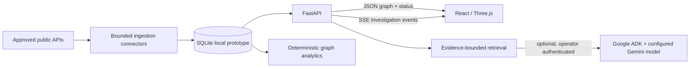

# System architecture

The local prototype stores source payloads and normalized entities in SQLite. A source record has a stable external ID, URL, retrieval time, and original JSON. An entity points to its source record. An edge can point to an evidence row. The only generated real edges today are literal title mentions of the collection query; they are marked `verified`. Search matches do not become relationship claims.

The Observatory renders visual samples alongside public records. Samples have `demo=1` and no evidence. The investigation endpoint emits each SSE event during real server execution. The UI highlights entity IDs supplied by those events. The optional ADK path receives a bounded evidence catalog and is gated by an admin token; anonymous requests use deterministic retrieval without paid model calls.

Production migration requires Cloud SQL PostgreSQL, durable raw record storage, scheduled jobs, migrations, and centralized rate limits. The included Terraform module is a Cloud Run API preview only and does not solve persistence.
